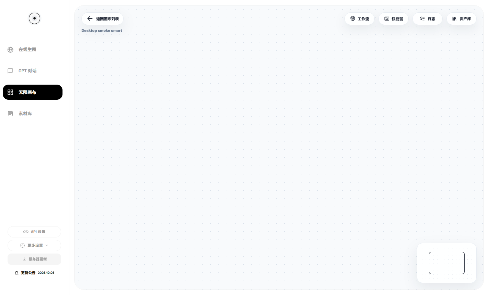
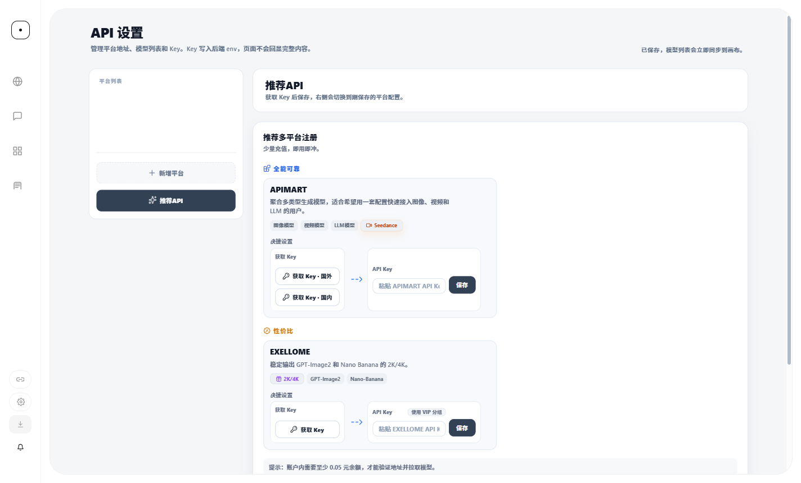

# Infinite Canvas Desktop

Infinite Canvas 的 Windows 独立桌面版本：保留普通画布、智能画布与现有 API 工作流，内置 Python，通过 GitHub Releases 更新完整桌面软件。

**原作者：[哔哩哔哩主页 · UID 78652351](https://space.bilibili.com/78652351)**  
本仓库是基于原作者作品的二次开发桌面版本，由 [sangui0312](https://github.com/sangui0312) 维护桌面适配和发布。原始画布能力归原作者及相应贡献者；请支持原作者。本项目不代表原作者官方发布或背书。

本次改造所依据的代码仓库：[liangjian785-debug/Infinite-Canvas](https://github.com/liangjian785-debug/Infinite-Canvas)。保留上游许可证，不将原作品改为 MIT 等其他许可。

**[下载 Windows 安装包](https://github.com/sangui0312/Infinite-Canvas-Desktop/releases/latest)** · **[更新记录](https://github.com/sangui0312/Infinite-Canvas-Desktop/releases)** · **[问题反馈](https://github.com/sangui0312/Infinite-Canvas-Desktop/issues)**

## 功能

- 独立 Electron 窗口，自带渲染引擎，无需安装 Chrome，没有浏览器地址栏或标签页。
- 普通 / 智能画布，支持节点、连线、提示词、图片/视频、循环及分组。
- 可配置 API 平台、地址、协议、模型和 Key，支持原有模型请求工作流。
- 项目与画布导入导出、素材管理、图片/视频和混合 ZIP 下载。
- 保留裁剪、拼接、电商压缩下载、图层拆分、PSD 导出等现有能力；模型相关功能需要对应平台支持。
- 安装版内置 Python、PSD 依赖与 FFmpeg，无需用户安装 Python 或 Node。
- 用户数据与程序分离；不会自动读取原 Web 目录或 Chrome 登录信息。
- 从 GitHub 检查、下载、校验桌面更新，由用户决定何时重启安装。

这不是离线模型软件。封装不会消除大画布、高分辨率素材原有的内存开销。

## 界面





## 安装

系统要求：Windows 10 / 11 x64。当前没有 macOS、Linux、ARM64 安装包。在线模型需要网络和自己的 API Key，安装和升级需要为运行副本及备份预留磁盘空间。

1. 打开 [最新 Release](https://github.com/sangui0312/Infinite-Canvas-Desktop/releases/latest)。
2. 下载 `InfiniteCanvas-Desktop-<版本>-x64.exe`，退出旧版 App 后运行。
3. 按向导选择安装位置。选择 `D:\` 这样的根目录时，会自动带上 `Infinite Canvas` 子文件夹；已有同名文件夹不重复追加。
4. 从桌面或开始菜单快捷方式启动。

普通用户只需安装 EXE。`InfiniteCanvas-Runtime-windows-x64-v1.zip` 是给源码构建者使用的，安装版已经包含这些运行依赖。

当前安装包未做 Windows 代码签名，系统可能显示来源提示。请核对本仓库 Release 与文件校验值，不使用未知镜像。

## 首次配置

打开 **API 设置**，通过 **新增平台** 或现有 **推荐 API** 入口填写自己的服务地址、协议、模型和 Key，保存后在画布选择平台与模型。

安装包不含维护者密钥，不赠送生成额度。推荐入口仅方便配置，账号、费用、模型和可用性由对应平台决定。

ModelScope、RunningHub、火山引擎的内置平台入口按现有规则隐藏；共享配置和后端兼容代码仍保留。隐藏入口不等于删除用户数据。

来源许可尚未确认的 `dreamina.exe` 不随公开安装包再分发；使用即梦等可选 CLI 时，请按 [官方说明](https://jimeng.jianying.com/cli) 自行安装和登录。不会携带或读取维护者的 CLI 登录目录。

## GitHub 软件更新

**0.1.x 用户需要手动覆盖安装 0.2.0 或更高版本一次**，之后使用 App 内的软件更新。

```text
检查 GitHub Releases → 查看版本和公告 → 点击下载完整包
→ 校验完成 → 点击“重启并安装” → 保存画布、确认运行任务
→ 停止 App 自己的服务 → 安装并重新启动
```

- 更新源固定为本仓库的 GitHub Releases，使用 `electron-updater`、`latest.yml` 和文件完整性校验。
- 下载、安装均由用户触发；取消弹窗和普通退出不会自动安装更新。
- 采用完整桌面安装包，可同时升级画布、Electron 壳、Python 和工具。
- 桌面版本（例如 `0.2.0`）与后端原有日期版本号不同；更新界面使用桌面版本。
- 下载/校验失败不会切换程序或替换个人数据；可检查网络后重试。
- 更高桌面版本启动时先备份旧运行副本，健康检查失败会尝试恢复旧运行副本。
- 运行副本恢复不等于整个 Electron 安装具有原子回滚保证。桌面壳或安装器自身无法运行时，从 [历史 Release](https://github.com/sangui0312/Infinite-Canvas-Desktop/releases) 获取安装包并先备份数据后排查。

完整桌面更新不再依赖旧 Web 更新服务器；Web/NAS 业务更新接口不能更新整个 App。

## 数据位置、迁移与备份

默认数据根：`%LOCALAPPDATA%\InfiniteCanvas`。

| 位置 | 内容 |
| --- | --- |
| 安装目录 | Electron、原始程序模板及许可证 |
| `runtime\app` | 实际运行的后端、Python、工具 |
| `runtime\shell-backup-*` | 更高桌面版本切换时保留的旧运行副本 |
| `userdata\data` | 项目、画布、配置、旧业务更新备份 |
| `userdata\assets` | 素材、上传与生成结果分类目录 |
| `userdata\output` | 兼容输出目录 |
| `userdata\API` | 本机 API 配置及授权信息 |
| `userdata\workflows` | 用户工作流 |
| `browser-profile` | 界面设置及桌面会话 |

首次启动使用独立的干净用户目录。旧 Web 项目请先导出，再从桌面版导入；API 配置需重新填写，原目录保留备份。

关闭 App 后备份整个 `userdata`；需要保留界面状态时同时备份 `browser-profile`。若修改了素材存储位置，外部目录也需要备份。API 文件可能包含密钥，不要上传到 GitHub 或作为问题附件。

卸载默认保留个人数据。首版不自动清理桌面壳升级备份，确认当前版本稳定后可自行管理。

## 启动与退出

本地后端由 App 自动管理，只监听 `127.0.0.1:31300`，每次启动使用独立会话认证，不影响原 Web 的 3000 端口。端口冲突时会提示并停止启动，不连接未知页面、不结束其他程序。

关闭窗口先尝试保存画布，有运行任务时询问等待还是退出/安装。退出只清理 App 自己启动的服务，不批量结束其他 Python 进程。关闭本地服务并不保证远端已提交的任务停止计费；恢复和重启不会自动重新提交生成请求。

## 从源码运行

开发环境：Windows x64、Git、Node.js 24.19+、Python 3.11+，推荐 PowerShell 7。开发机 Python 只用于准备运行包；App 后端使用随包的 Python 3.10.11。

```powershell
git clone https://github.com/sangui0312/Infinite-Canvas-Desktop.git
cd Infinite-Canvas-Desktop
python -X utf8 tools/prepare_runtime.py
npm ci
node --use-system-ca node_modules/electron/install.js
npm run dev
```

`runtime-manifest.json` 固定运行包地址、大小和 SHA-256。已有文件也会核验；缺少依赖时从指定 Release 下载。不要通过关闭 TLS 或跳过哈希解决下载问题。

开发和 `--desktop-smoke` 模式不执行真实更新安装，防止开发目录被安装器覆盖。

```text
desktop/                 Electron 主进程、preload、更新控制器
backend/main.py          独立桌面后端副本
backend/desktop_entry.py 会话认证、服务入口、进程管理与恢复
backend/static/          画布界面与桌面更新界面
backend/workflows/       默认工作流
backend/tools/           工具、连接器资源
build/installer.nsh      安装目录补全
tools/                   运行依赖准备、构建和验证
tests/                   后端、壳、更新、安装路径检查
runtime-manifest.json    固定运行包与逐文件校验清单
```

第三方运行二进制作为 Release 资源分发，不放入 Git 历史。日常修改直接在本仓库 `backend` 副本进行，构建不依赖原 Web 工作区。

## 构建安装包

准备运行包与开发依赖后：

```powershell
pwsh -File tools/build_windows.ps1
# 同时安装 npm 依赖：
pwsh -File tools/build_windows.ps1 -InstallDependencies
```

输出在 `dist`：安装 EXE、同名 `.exe.blockmap`、`latest.yml`、完整 `win-unpacked` 测试目录。不能只复制未安装目录中的 EXE。

构建默认不发布。私人配置、素材、测试数据、缓存、备份和登录态不进入安装包。

## 维护者发布步骤

1. 更新 `package.json` / lockfile 的版本和 `backend/static/desktop-update-notes.json` 公告。
2. 依赖变化时重新生成运行包，并更新固定资源 URL 和校验清单。
3. 构建并执行针对性测试，核验资源、许可、文件大小与哈希。
4. 提交源码，推送本仓库并为该提交建立 `v<版本>` 标签，创建草稿 Release。
5. 上传安装 EXE、blockmap、`latest.yml`、`SHA256SUMS.txt`；需要的运行包和对应源码附件一并上传。
6. 核对全部资源和版本后发布，避免客户端看到资源不齐的更新清单。
7. 检查匿名下载、版本检测及文件校验后通知用户。

目前采用维护者本机构建发布，没有声称已配置无人值守的 GitHub Actions 流水线。客户端不含 GitHub 发布 Token。

## 常见问题

**0.1.1 提示没有更新？** 旧版没有 GitHub 桌面更新，需要先手动安装 0.2.0 或更高版一次。

**下载失败？** 检查 GitHub 连通性后重试，也可从官方 Release 手动下载完整包。校验失败的文件不要运行。

**端口 31300 被占用？** 先确认是否已有 App 实例或其他程序占用；不要批量结束所有 Python 进程。

**看不到旧 Web 画布？** 两者数据隔离，通过项目/画布导入迁移，不自动扫描旧目录。

**旧节点为什么只能查看结果？** 六类停用独立节点已清理专属执行界面，保留历史结果兼容；不代表 API 中共享模型全部被删除。

**首次启动或升级后稍慢？** 需要复制或切换后端运行副本，再等待健康检查。

**能离线生成吗？** 部分本地查看、编辑和文件工具可离线；API 模型仍需要网络与用户密钥。

## 验证边界与反馈

定点检查覆盖来源认证、窗口启动、普通/智能画布保存、API 空态、下载、ZIP/PSD、运行副本升级恢复，以及更新状态、取消、错误和安装前处理。

真实付费模型、全部平台组合、每种 Windows 环境、交互式拖放/剪贴板与完整操作系统安装并非每次都逐项验证，请以具体 Release 的验收说明为准。

反馈请附桌面版本、Windows 版本、复现步骤和脱敏截图；不要附 Key、Cookie、个人数据目录或私人生成内容。

## 许可与署名

**原作者：[哔哩哔哩 UID 78652351](https://space.bilibili.com/78652351)**。

沿用上游 [LICENSE](LICENSE)，其中明确写明：

> 可以自己使用和公司使用，禁止用于任何形式的修改封装成商业产品，商用须取得授权。
>
> 根据代码二次开发的软件必须保持开源并注明来源作者。

请阅读完整许可，需要商业授权时联系相应权利人。二次开发与公开源码不代表获得额外商业授权。

Electron、Chromium、Python、NumPy、pytoshop、FFmpeg 等组件保留其各自许可证。参见 [THIRD_PARTY_NOTICES.md](THIRD_PARTY_NOTICES.md)、安装目录中的许可文件，以及 Release 的对应源码/来源附件。
